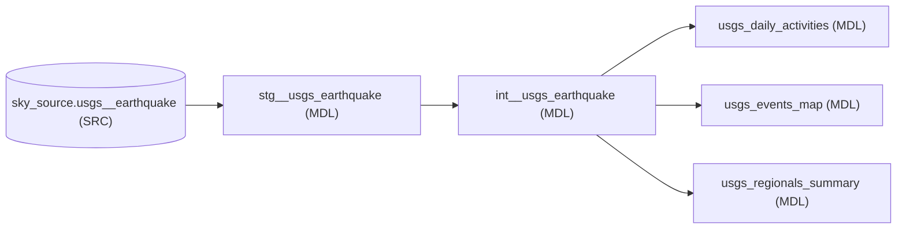

# 🌍 Earthquake Tracker Analytics

A Streamlit dashboard deployed as a **Databricks App**, visualizing global USGS earthquake data served from Unity Catalog: an interactive 3D earthquake map (sized and colored by significance), daily event trends, top regions, and a table of recent high-significance events.

---

## The Two Files That Matter

| File | Purpose |
| --- | --- |
| `app.py` | The entire dashboard — data loading, 3D pydeck map, metrics, charts |
| `app.yaml` | App configuration — launch command and environment variables |

`requirements.txt` lists the Python dependencies (streamlit, pydeck, pandas, databricks-sql-connector).

---

## Data Lineage (dbt)

The tables the app reads are dbt models built from raw USGS earthquake data:



The dbt DAG for reference:


> ℹ️ Save the DAG screenshot from the dbt editor as `dbt_lineage.png` next to this README so the image above renders on GitHub.

The app queries the three final mart tables in `sky.dbt_skymiid`:

- `usgs__events_map` — per-event map data (lat/lon, magnitude, significance, depth, tsunami flag)
- `usgs__daily_activities` — daily event counts for the time-series chart
- `usgs__regionals_summary` — event counts by region for the top-regions chart

The raw source (`sky.source.usgs__earthquake`) is refreshed from the USGS Earthquake API by the `usgs_ai_extract` notebook in this repo.

---

## Getting Started

### 1. Prerequisites

- A Databricks workspace with Unity Catalog
- A **SQL Warehouse** (the app reads through it)
- A **catalog and schema** containing the three mart tables above
- Python 3.10+ (for local development)

### 2. Configure `app.yaml`

Point the app at your environment:

```yaml
command: ["streamlit", "run", "app.py"]

env:
  - name: "DATABRICKS_WAREHOUSE_ID"   # SQL Warehouses → your warehouse → Connection Details
    value: "your-sql-warehouse-id"
  - name: "CATALOG"                   # Unity Catalog name (e.g. sky)
    value: "sky"
  - name: "SCHEMA"                    # Schema holding the mart tables (e.g. dbt_skymiid)
    value: "dbt_skymiid"
```

### 3. Build the Data

Refresh the raw USGS data (run `sky_analytics/Sources/usgs_ai_extract`), then run your dbt project so the staging → intermediate → mart models are up to date. The app fails gracefully but shows no data until these tables exist.

### 4. Deploy the App

**Option A — Databricks UI:** Workspace → **Apps** → *Create app* → choose your Git folder as the source and select `app.yaml`'s folder as the app root.

**Option B — Databricks CLI:**

```bash
databricks apps create earthquake-tracker-analytics \
  --source-code-path /Workspace/Users/<your-email>/sky_analytics/apps/earthquake_tracker

databricks apps deploy earthquake-tracker-analytics \
  --source-code-path /Workspace/Users/<your-email>/sky_analytics/apps/earthquake_tracker
```

### 5. Open the App

Find it under **Apps** in your workspace. Authentication to Databricks and the SQL warehouse is handled automatically by the app runtime — no tokens needed.

---

## Troubleshooting

| Symptom | Cause / Fix |
| --- | --- |
| Query resolves to `None.None.usgs__...` | `CATALOG` / `SCHEMA` env vars are not set — they must be present in `app.yaml` |
| App renders nothing when run in a notebook | Streamlit apps must run as a Databricks App (or `streamlit run app.py` locally), not inside a notebook cell |
| `Failed to load data: ... TABLE_OR_VIEW_NOT_FOUND` | Mart tables don't exist in `{CATALOG}.{SCHEMA}` yet — run the dbt models first |
| Permission errors on the warehouse | Grant the app's service principal USE + SELECT on the catalog/schema and CAN USE on the SQL warehouse |
